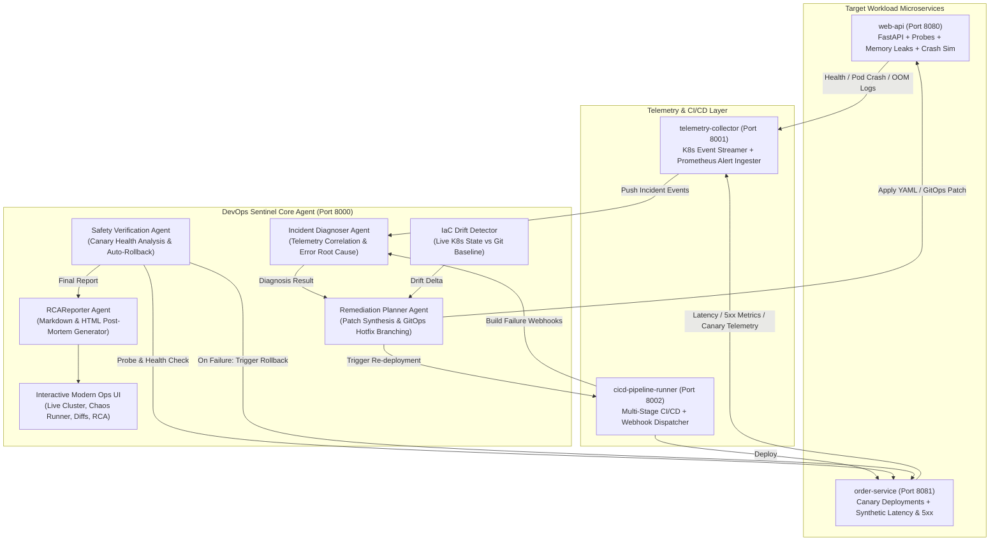

# DevOps Sentinel Agent: Project Execution & Architecture Document

---

## 👤 Project Metadata

- **Project Name**: DevOps Sentinel Agent – Autonomous CI/CD Failure Healing, Kubernetes Deployment Verification, IaC Drift Detection & Auto-Remediation System
- **Candidate / Student Name**: Kaushal Patil
- **Student ID**: 13408
- **Email ID**: patilkaushal89@gmail.com
- **GitHub Repository**: [https://github.com/kaushalpatil205/devops-sentinel-agent](https://github.com/kaushalpatil205/devops-sentinel-agent)
- **Primary Domain**: DevOps & Cloud Infrastructure Automation (Multi-Agent Autonomous Operations)

---

## 📌 Executive Summary & Problem Statement

Modern cloud-native environments frequently suffer from production downtime caused by preventable operational failures:
1. **Container Memory Exhaustion (`OOMKilled`)**: Traffic surges causing containers to exceed pod memory limits, resulting in Linux kernel SIGKILL (exit code 137) and cascading service failures.
2. **Probe Port Mismatches**: Infrastructure manifests specifying incorrect probe ports (e.g. port 3000 instead of 8080), resulting in HTTP 502 / connection refused failures during Kubernetes rollouts.
3. **Broken CI/CD Pipelines**: Unpinned dependencies or missing wheels breaking automated build pipelines.
4. **Out-of-Band IaC Configuration Drift**: Engineers making direct manual changes in production clusters (`kubectl edit`, scaling replicas, debugging image overrides) that diverge from Git declarative baselines.
5. **Canary Deployment Degradation**: Regressive code versions breaching SLA thresholds (spiking 5xx error rates) that require immediate automated rollback.

**DevOps Sentinel** solves these challenges by deploying an intelligent multi-agent autonomous system that continuously observes, diagnoses, synthesizes precision code/manifest patches, verifies health, executes automated rollbacks when necessary, and generates publication-grade Root Cause Analysis (RCA) post-mortems.

---

## 🏛️ System Architecture & Multi-Microservice Fleet

The project is built as a **5-microservice distributed ecosystem** orchestrated via a unified supervisor and container composition:



### Microservice Catalog

| Microservice | Port | Directory | Core Functionality |
|---|---|---|---|
| **DevOps Sentinel Core** | `8000` | `sentinel/` | Autonomous multi-agent orchestrator, state machine, REST API, WebSocket streams, and Cyberpunk Dark-Mode Ops Dashboard. |
| **Telemetry Collector** | `8001` | `services/telemetry_collector/` | Continuous probe polling, Prometheus Alertmanager alert receiver (`/webhook/alerts`), and Kubernetes event streamer (`/events/k8s`). |
| **CI/CD Pipeline Runner** | `8002` | `services/cicd_runner/` | Multi-stage pipeline simulator (checkout, lint, test, build, deploy), failure notification webhooks, and hotfix re-run engine. |
| **Target: Web API** | `8080` | `services/web_api/` | Workload microservice with `/healthz`, `/ready`, `/metrics`, and chaos injection endpoints (`/simulate/memory-load`, `/simulate/crash`). |
| **Target: Order Service** | `8081` | `services/order_service/` | E-commerce workload with canary traffic splitting (v1 vs v2), synthetic error rate spikes (`/simulate/canary`), and rollback verification. |

---

## 🧠 Autonomous Multi-Agent Reasoning Loop

The Sentinel Core operates via specialized subagents:
1. **Incident Diagnoser Agent** (`sentinel.core.diagnoser`): Correlates container exit codes, kernel signals (e.g. exit 137), pod logs, and K8s event streams to isolate technical root causes with high confidence scoring.
2. **IaC Drift Detector** (`sentinel.core.drift_detector`): Performs deep AST comparisons between declarative Git baseline manifests and live Kubernetes cluster state, isolating unauthorized manual changes.
3. **Remediation Planner Agent** (`sentinel.core.remediator`): Synthesizes targeted diffs (YAML resource limit scaling, probe port alignment, Dockerfile layer patches), creates hotfix Git branches, and applies fixes.
4. **Safety Verification Agent** (`sentinel.core.verifier`): Evaluates post-deployment health probes and latency metrics; triggers immediate rolling rollback if canary error thresholds breach.
5. **RCAReporter Agent** (`sentinel.core.rca_generator`): Auto-generates complete post-mortem documents in Markdown and interactive HTML including executive summaries, timeline metrics, and architectural prevention recommendations.

---

## 🧪 Built-in Scenarios & Automated Verification

### The 5 Operational Scenarios

1. **Scenario 1: Kubernetes Pod OOMKilled (Exit Code 137)**
   - Trigger: Pod memory consumption exceeds allocated limit (128Mi) under surge.
   - Action: Agent detects SIGKILL exit code 137, scales limit to 512Mi in deployment manifest, triggers rolling rollout, and verifies pod readiness.
2. **Scenario 2: Readiness Probe Port Mismatch (502 / Connection Refused)**
   - Trigger: Manifest specifies probe port 3000 while application listens on 8080.
   - Action: Agent correlates connection refusal with container port binding, patches manifest to port 8080, and verifies healthy probe responses.
3. **Scenario 3: CI/CD Build Missing Dependency**
   - Trigger: Build fails on missing Python package (`pydantic`).
   - Action: Agent parses stack trace, injects package dependency into Dockerfile/requirements, commits hotfix branch, and resumes CI pipeline to green.
4. **Scenario 4: IaC Configuration Drift Detection & Reconciliation**
   - Trigger: Production deployment has replicas reduced and untracked debug image applied manually out-of-band.
   - Action: Agent performs recursive structural diff, detects 2 conflicting fields, and outputs reconciliation strategy to restore Git baseline.
5. **Scenario 5: Canary Health SLA Breach & Automated Rollback**
   - Trigger: Canary release causes 18% HTTP 500 error rate spike.
   - Action: Agent detects SLA threshold breach, aborts canary release, executes automated rollback to previous stable revision, and publishes RCA.

### Test Results (25 / 25 Automated Tests Passing)

```
============================= test session starts ==============================
platform darwin -- Python 3.14.7, pytest-9.2.0, pluggy-1.7.0
collected 25 items

tests/test_api.py::test_api_status PASSED                                [  4%]
tests/test_api.py::test_api_scenarios_list PASSED                        [  8%]
tests/test_api.py::test_api_run_scenario_oom PASSED                      [ 12%]
tests/test_api.py::test_api_cluster_pods PASSED                          [ 16%]
tests/test_api.py::test_api_github_webhook PASSED                        [ 20%]
tests/test_diagnoser.py::test_diagnose_oomkilled PASSED                  [ 24%]
tests/test_diagnoser.py::test_diagnose_port_mismatch PASSED              [ 28%]
tests/test_diagnoser.py::test_diagnose_missing_dependency PASSED         [ 32%]
tests/test_diagnoser.py::test_diagnose_canary_sla_breach PASSED          [ 36%]
tests/test_drift_detector.py::test_zero_drift PASSED                     [ 40%]
tests/test_drift_detector.py::test_detected_drift_replica_and_image PASSED [ 44%]
tests/test_microservices.py::test_web_api_health_and_probes PASSED       [ 48%]
tests/test_microservices.py::test_web_api_metrics PASSED                 [ 52%]
tests/test_microservices.py::test_web_api_memory_and_crash_simulation PASSED [ 56%]
tests/test_microservices.py::test_order_service_lifecycle PASSED         [ 60%]
tests/test_microservices.py::test_order_service_canary_and_rollback PASSED [ 64%]
tests/test_telemetry_collector_endpoints PASSED   [ 68%]
tests/test_telemetry_collector_alert_ingestion PASSED [ 72%]
tests/test_cicd_runner_pipeline_success PASSED    [ 76%]
tests/test_cicd_runner_failure_and_remediation PASSED [ 80%]
tests/test_sentinel_services_status_endpoint PASSED [ 84%]
tests/test_sentinel_chaos_trigger PASSED          [ 88%]
tests/test_remediator.py::test_remediate_oomkilled_plan PASSED           [ 92%]
tests/test_remediator.py::test_remediate_port_mismatch_plan PASSED       [ 96%]
tests/test_verifier.py::test_verify_healthy_deployment PASSED            [100%]

======================== 25 passed, 1 warning in 0.70s =========================
```

---

## 💻 How to Run & Verify

### 1. Multi-Microservice Fleet Launch
```bash
cd devops-sentinel-agent
source .venv/bin/activate

# Launches all 5 microservices concurrently with health polling:
python run_services.py
```
Access points:
- **Sentinel Core UI & API**: [http://localhost:8000](http://localhost:8000)
- **Telemetry Collector**: [http://localhost:8001/status](http://localhost:8001/status)
- **CI/CD Pipeline Runner**: [http://localhost:8002/status](http://localhost:8002/status)
- **Target Web API**: [http://localhost:8080/healthz](http://localhost:8080/healthz)
- **Target Order Service**: [http://localhost:8081/healthz](http://localhost:8081/healthz)

### 2. Autonomous Healing Demonstration
```bash
python demo_run.py
```

### 3. Containerized Deployment
```bash
docker-compose up --build
```

---

## 📝 Important Project Notice

> **Note**: This project is created temporarily and serves as a foundational implementation. It might also contain further modifications, enhancements, or changes later on when found necessary during subsequent development phases.
