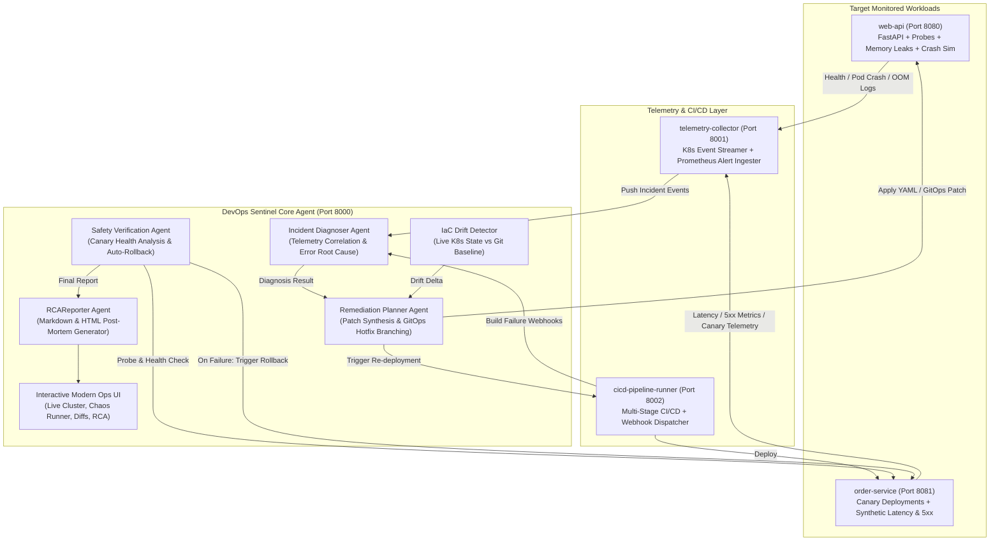

# 🛡️ DevOps Sentinel Agent: Multi-Microservice Autonomous Operations Fleet

> **Autonomous CI/CD Failure Healing, Kubernetes Deployment Verification, IaC Drift Detection & Auto-Remediation with Root Cause Analysis (RCA)**

[](https://www.python.org/downloads/)
[](https://fastapi.tiangolo.com)
[](https://kubernetes.io)
[]()
[]()
[](LICENSE)

---

## 📌 Executive Overview

**DevOps Sentinel** is a complete, multi-microservice autonomous operations system designed for cloud-native engineering and SRE teams. It directly implements the specifications from the DevOps Agent project requirements:
- **Item 7 (CI/CD Pipeline Automation)**: *"Agent detects code merges, triggers CI/CD pipeline, deploys to Kubernetes, performs health checks, rolls back on failure, and delivers a deployment summary with root cause analysis."*
- **Item 11 (Cloud Infrastructure Remediation)**: *"Agent detects CI/CD pipeline failures and IaC configuration drift, generates and applies remediation patches, resumes the deployment pipeline, and delivers an RCA to the cloud engineering team."*

The platform automates the end-to-end incident management lifecycle:
1. **Detects** build breakages, Kubernetes pod crashes (`CrashLoopBackOff`, `OOMKilled`, `ReadinessProbeFailed`), port misconfigurations, and out-of-band **IaC configuration drift**.
2. **Diagnoses** technical root causes using multi-source telemetry correlation (container exit codes, kernel OOM signals, unified diffs, pod logs, and K8s event streams).
3. **Synthesizes** precision remediation patches (manifest YAML scaling, probe alignment, Dockerfile dependency injection).
4. **Verifies** post-remediation health in a canary/staging loop, executing **automated safe rollbacks** if health thresholds breach.
5. **Generates** publication-grade **Root Cause Analysis (RCA)** post-mortems in Markdown and interactive HTML.

---

## 🌐 Multi-Microservice Ecosystem Architecture

The system consists of **5 decoupled microservices** operating collaboratively:



### The 5 Microservices

| Service | Port | Directory | Role & Key Endpoints |
|---|---|---|---|
| **DevOps Sentinel Core** | `8000` | `sentinel/` | Autonomous orchestrator, multi-agent reasoning loop, REST API & Web Dashboard (`/api/status`, `/api/scenarios`, `/api/incidents`, `/api/services/status`, `/api/chaos/trigger`) |
| **Telemetry Collector** | `8001` | `services/telemetry_collector/` | Continuous health-checker, K8s event listener, Prometheus alert ingester (`/status`, `/targets`, `/webhook/alerts`, `/events/k8s`) |
| **CI/CD Pipeline Runner** | `8002` | `services/cicd_runner/` | Multi-stage pipeline simulator (checkout, lint, test, build, deploy) with webhook dispatcher and hotfix re-run handler (`/pipelines`, `/pipelines/trigger`, `/pipelines/remediate`) |
| **Target: Web API** | `8080` | `services/web_api/` | Target application with Kubernetes liveness (`/healthz`) & readiness (`/ready`) probes, Prometheus metrics (`/metrics`), and fault injection (`/simulate/memory-load`, `/simulate/crash`, `/simulate/misconfig`) |
| **Target: Order Service** | `8081` | `services/order_service/` | E-commerce orders with canary traffic splitting (v1 vs v2), synthetic error injection (`/simulate/canary`), and safe rollback (`/simulate/rollback`) |

---

## 🚀 Key Capabilities

| Capability | Description |
|---|---|
| **OOMKilled Auto-Healing** | Intercepts Linux kernel SIGKILL (exit code 137), calculates memory usage headroom, patches Kubernetes limits (e.g. `128Mi` $\rightarrow$ `512Mi`), and triggers rolling restarts. |
| **Probe Port Alignment** | Resolves HTTP 502 / Connection Refused by analyzing container socket binding vs manifest probe definitions, patching port mismatches. |
| **CI/CD Build Healing** | Parses stack traces (`ModuleNotFoundError`, syntax errors), patches `Dockerfile` or `requirements.txt`, and resumes CI/CD execution. |
| **IaC Configuration Drift** | Recursively computes deep structural diffs between Git declarative manifests and live Kubernetes cluster state, generating reconciliation patches. |
| **Canary SLA Verification & Rollback** | Monitors live error rates and latency SLAs during canaries; automatically initiates rolling rollback on regression. |
| **Automated RCA Generation** | Generates executive summaries, incident timelines, diagnostic evidence, diffs, and prevention recommendations. |

---

## 🧪 Built-in Benchmark Scenarios

The agent includes 5 out-of-the-box benchmark scenarios runnable via CLI, Web Dashboard, and API:

1. `oom_killed`: Pod crashes due to memory limits under traffic spike. Agent patches memory limit, restarts, and verifies health.
2. `probe_port_mismatch`: Readiness probe targeting port 3000 throws connection refused (app listens on 8080). Agent aligns probe port.
3. `build_dependency_missing`: CI/CD build fails due to missing package in test suite. Agent injects dependency into `Dockerfile`.
4. `iac_drift`: Live cluster deployment has replicas and image modified out-of-band. Agent flags drift and outputs reconciliation plan.
5. `canary_regression`: Canary deployment generates 18% HTTP 500 error rate. Agent executes immediate automated rollback to previous stable revision.

---

## 💻 Quickstart Guide

### 1. Prerequisites
- Python 3.10+ (tested with Python 3.11 / 3.14)
- (Optional) `docker` and `docker-compose` for containerized mode

### 2. Setup Virtual Environment
```bash
cd /Users/Vraj/Downloads/devops-sentinel-agent
source .venv/bin/activate
pip install -r requirements.txt
```

### 3. Run All 5 Microservices Concurrently
Launch the complete multi-microservice fleet with the built-in supervisor:
```bash
python run_services.py
```
This boots all 5 microservices in parallel, confirms their readiness, and presents their URLs:
- **Sentinel Dashboard & Core API**: [http://localhost:8000](http://localhost:8000)
- **Telemetry Collector**: [http://localhost:8001/status](http://localhost:8001/status)
- **CI/CD Pipeline Runner**: [http://localhost:8002/status](http://localhost:8002/status)
- **Target Web API**: [http://localhost:8080/healthz](http://localhost:8080/healthz)
- **Target Order Service**: [http://localhost:8081/healthz](http://localhost:8081/healthz)

To run a fast preflight check:
```bash
python run_services.py --check
```

### 4. Run the Autonomous Self-Healing Demo
Execute all 5 scenarios end-to-end directly in your terminal:
```bash
python demo_run.py
```

### 5. Run via CLI Tool
```bash
# Run all benchmark scenarios
python -m sentinel.cli.main test-all

# Run individual scenario
python -m sentinel.cli.main run-scenario oom_killed

# Scan for IaC configuration drift
python -m sentinel.cli.main reconcile
```

---

## 🧪 Running Automated Tests

Run the comprehensive pytest suite covering all 5 microservices, diagnoser, remediator, verifier, drift detector, and REST API (25 tests):
```bash
pytest tests/ -v
```

---

## 🐳 Docker Compose & Kubernetes Deployment

### Run via Docker Compose
All 5 microservices are configured in `docker-compose.yml`:
```bash
docker-compose up --build
```

### Deploy to Kubernetes Cluster
```bash
kubectl apply -f k8s/rbac.yaml
kubectl apply -f k8s/deployment.yaml
kubectl apply -f manifests/web-api-deployment.yaml
kubectl apply -f manifests/order-service-deployment.yaml
kubectl apply -f manifests/telemetry-collector-deployment.yaml
```

---

## 📂 Repository File Structure

```
devops-sentinel-agent/
├── README.md                                  # Complete documentation & architecture guide
├── requirements.txt                           # Project dependencies
├── Dockerfile                                 # Sentinel Core container image
├── docker-compose.yml                         # 5-microservice orchestration spec
├── demo_run.py                                # End-to-end benchmark demo runner
├── run_services.py                            # Multi-microservice fleet supervisor
│
├── services/                                  # Satellite Microservices Fleet
│   ├── web_api/                               # Target Workload: Web API Microservice
│   │   ├── app.py                             # FastAPI probes, metrics & chaos simulation
│   │   ├── Dockerfile
│   │   └── requirements.txt
│   ├── order_service/                         # Target Workload: Order Processing Microservice
│   │   ├── app.py                             # Canary deployments & rollback testing
│   │   ├── Dockerfile
│   │   └── requirements.txt
│   ├── telemetry_collector/                   # Telemetry Collector Microservice
│   │   ├── collector.py                       # K8s event listener & Prometheus alert webhook
│   │   ├── Dockerfile
│   │   └── requirements.txt
│   └── cicd_runner/                           # CI/CD Pipeline Runner Microservice
│       ├── runner.py                          # Multi-stage CI simulator & webhook engine
│       ├── Dockerfile
│       └── requirements.txt
│
├── sentinel/                                  # DevOps Sentinel Core Package
│   ├── config.py                              # Configuration & autonomy flags
│   ├── core/                                  # Intelligent Multi-Agent System
│   │   ├── orchestrator.py                    # Master incident lifecycle loop
│   │   ├── diagnoser.py                       # Root Cause Analysis agent
│   │   ├── remediator.py                      # GitOps patch synthesis agent
│   │   ├── verifier.py                        # Deployment health verification agent
│   │   ├── drift_detector.py                  # Declarative IaC drift detector
│   │   └── rca_generator.py                   # Post-Mortem Markdown/HTML generator
│   ├── connectors/                            # Infrastructure Connectors
│   │   ├── k8s_client.py                      # Kubernetes client & state manager
│   │   ├── git_client.py                      # Git branch & diff manager
│   │   ├── cicd_runner.py                     # Pipeline execution connector
│   │   └── iac_parser.py                      # YAML & Dockerfile AST parser
│   ├── simulator/                             # Scenario Simulation Harness
│   │   ├── cluster_sim.py                     # Sandbox orchestrator
│   │   └── scenarios.py                       # 5 production failure definitions
│   ├── api/                                   # REST API & Webhooks
│   │   └── server.py                          # Sentinel Core FastAPI server
│   ├── cli/                                   # CLI Tooling
│   │   └── main.py                            # Rich command line interface
│   └── web/static/                            # Real-Time Operations Control Center
│       ├── index.html                         # Interactive dashboard UI
│       ├── style.css                          # Dark-mode ops theme
│       └── app.js                             # Live state & RCA renderer
│
├── manifests/                                 # Kubernetes workloads & service specs
├── k8s/                                       # Sentinel Operator deployment & RBAC
└── tests/                                     # Automated test suite (25 tests)
    ├── test_api.py
    ├── test_diagnoser.py
    ├── test_drift_detector.py
    ├── test_microservices.py
    ├── test_remediator.py
    └── test_verifier.py
```

---

## 📜 License
MIT License. Built for autonomous cloud operations and SRE efficiency.
