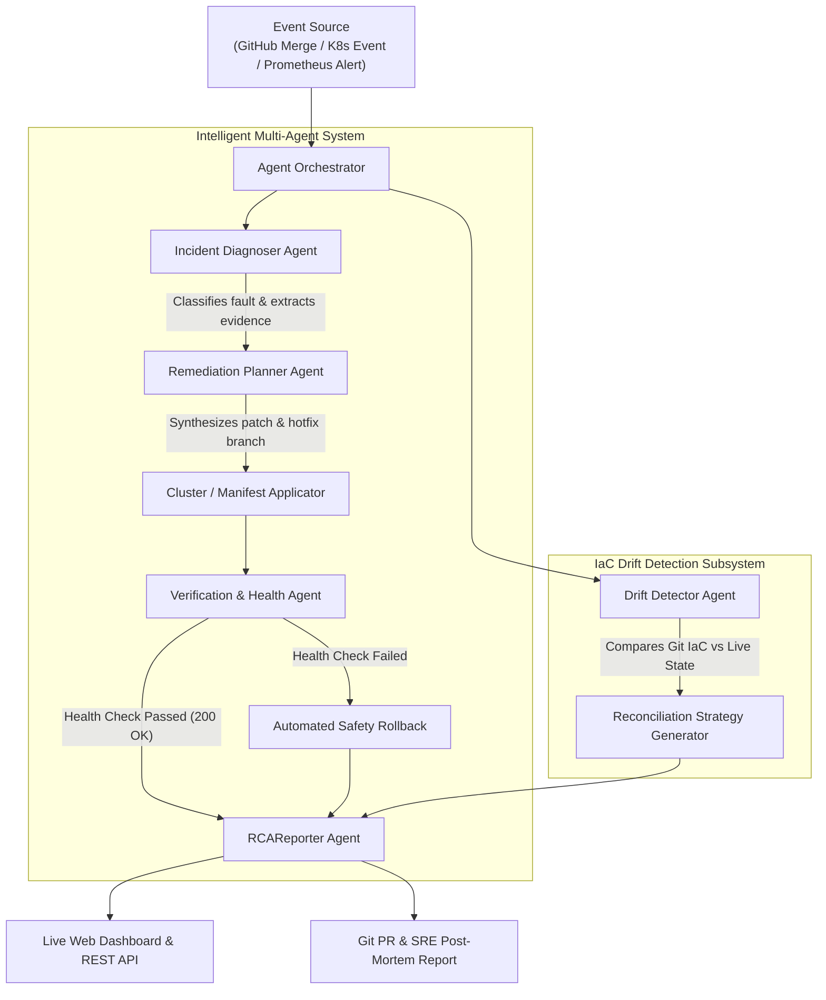

# 🛡️ DevOps Sentinel Agent

> **Autonomous CI/CD Failure Healing, Kubernetes Deployment Verification, IaC Drift Detection & Auto-Remediation with Root Cause Analysis (RCA)**

[](https://www.python.org/downloads/)
[](https://fastapi.tiangolo.com)
[](https://kubernetes.io)
[]()
[](LICENSE)

---

## 📌 Executive Overview

**DevOps Sentinel Agent** is a multi-agent autonomous operations system designed for cloud-native engineering and SRE teams. It automates the end-to-end incident management lifecycle:
1. **Detects** build breakages, Kubernetes pod crashes (`CrashLoopBackOff`, `OOMKilled`, `ReadinessProbeFailed`), port misconfigurations, and out-of-band **IaC configuration drift**.
2. **Diagnoses** technical root causes using multi-source telemetry correlation (container exit codes, kernel OOM signals, unified diffs, pod logs, and K8s event streams).
3. **Synthesizes** precision remediation patches (manifest YAML scaling, probe alignment, Dockerfile dependency injection).
4. **Verifies** post-remediation health in a canary/staging loop, executing **automated safe rollbacks** if health thresholds breach.
5. **Generates** publication-grade **Root Cause Analysis (RCA)** post-mortems in Markdown and HTML.

This project implements the core specifications from the DevOps Agent project requirements:
- **Item 7 (CI/CD Pipeline Automation)**: *"Agent detects code merges, triggers CI/CD pipeline, deploys to Kubernetes, performs health checks, rolls back on failure, and delivers a deployment summary with root cause analysis."*
- **Item 11 (Cloud Infrastructure Remediation)**: *"Agent detects CI/CD pipeline failures and IaC configuration drift, generates and applies remediation patches, resumes the deployment pipeline, and delivers an RCA to the cloud engineering team."*

---

## 🏛️ Architecture & Autonomous Workflow



---

## 🚀 Key Capabilities

| Capability | Description |
|---|---|
| **OOMKilled Auto-Healing** | Intercepts Linux kernel SIGKILL (exit code 137), calculates memory usage headroom, patches Kubernetes limits (e.g. `128Mi` $\rightarrow$ `512Mi`), and triggers rolling restarts. |
| **Probe Port Alignment** | Resolves HTTP 502 / Connection Refused by analyzing container socket binding vs manifest probe definitions, patching port mismatches. |
| **CI/CD Build Healing** | Parses stack traces (`ModuleNotFoundError`, syntax errors), patches `Dockerfile` or `requirements.txt`, and resumes CI/CD execution. |
| **IaC Configuration Drift** | Recursively computes deep structural diffs between Git declarative manifests and live Kubernetes cluster state, generating reconciliation patches. |
| **Canary SLA Verification & Rollback** | Monitors live error rates and latency SLAs during canaries; automatically initiates rolling rollback on regression. |
| **Automated RCA Generation** | Generates executive summaries, incident timelines, diagnostic evidence, diffs, and prevention recommendations. |

---

## 🧪 Built-in Benchmark Scenarios

The agent includes 5 out-of-the-box benchmark scenarios runnable both via CLI and Web Dashboard:

1. `oom_killed`: Pod crashes due to memory limits under traffic spike. Agent patches memory limit, restarts, and verifies health.
2. `probe_port_mismatch`: Readiness probe targeting port 3000 throws connection refused (app listens on 8080). Agent aligns probe port.
3. `build_dependency_missing`: CI/CD build fails due to missing package in test suite. Agent injects dependency into `Dockerfile`.
4. `iac_drift`: Live cluster deployment has replicas and image modified out-of-band. Agent flags drift and outputs reconciliation plan.
5. `canary_regression`: Canary deployment generates 18% HTTP 500 error rate. Agent executes immediate automated rollback to previous stable revision.

---

## 💻 Quickstart Guide

### 1. Prerequisites
- Python 3.10+
- (Optional) `kubectl` and `docker` for live cluster mode

### 2. Installation
```bash
# Navigate to project directory
cd /Users/Vraj/Downloads/devops-sentinel-agent

# Activate virtual environment
source .venv/bin/activate

# Install dependencies (if not already installed)
pip install -r requirements.txt
```

### 3. Run the Demonstration Benchmark
Run all 5 scenarios end-to-end directly in your terminal:
```bash
python demo_run.py
```
Or via the CLI tool:
```bash
python -m sentinel.cli.main test-all
```

### 4. Run an Individual Scenario via CLI
```bash
# Run OOMKilled auto-healing
python -m sentinel.cli.main run-scenario oom_killed

# Run Probe port alignment
python -m sentinel.cli.main run-scenario probe_port_mismatch

# Run Canary rollback
python -m sentinel.cli.main run-scenario canary_regression
```

### 5. Launch the Web Dashboard & API
Start the real-time operations dashboard:
```bash
python -m sentinel.cli.main serve --port 8000
```
Open **[http://localhost:8000](http://localhost:8000)** in your browser to interact with the visual dashboard, trigger scenarios with 1 click, view synthesized diffs, and inspect post-mortems.

---

## 🧪 Running the Test Suite

Run the full pytest suite with 14 automated tests:
```bash
pytest tests/ -v
```

---

## 📡 REST API & Webhook Reference

| Method | Endpoint | Description |
|---|---|---|
| `GET` | `/api/status` | Agent health, active incident count, mode |
| `GET` | `/api/activity` | Real-time agent thought & action stream |
| `GET` | `/api/scenarios` | List available test scenarios |
| `POST` | `/api/scenarios/run/{id}` | Execute scenario and return remediation trace |
| `GET` | `/api/cluster/pods` | Inspect cluster pods and health status |
| `GET` | `/api/cluster/drift` | Run IaC configuration drift scan |
| `POST` | `/api/webhook/github` | Handle code merge webhook (CI/CD $\rightarrow$ deploy $\rightarrow$ verify loop) |
| `POST` | `/api/incidents/trigger` | Trigger custom anomaly remediation |

---

## 🐳 Docker & Kubernetes Operator Deployment

### Run via Docker Compose
```bash
docker-compose up --build
```

### Deploy into Kubernetes Cluster
```bash
kubectl apply -f k8s/rbac.yaml
kubectl apply -f k8s/deployment.yaml
```

---

## 📂 Project Structure

```
devops-sentinel-agent/
├── README.md                      # Comprehensive project documentation
├── requirements.txt               # Python package dependencies
├── Dockerfile                     # Production container image
├── docker-compose.yml             # Local orchestration spec
├── demo_run.py                    # End-to-end benchmark demo runner
├── sentinel/                      # Core package
│   ├── config.py                  # Agent configuration & policies
│   ├── core/                      # Agent reasoning & orchestration
│   │   ├── orchestrator.py        # Master incident lifecycle loop
│   │   ├── diagnoser.py           # Intelligent RCA diagnostic agent
│   │   ├── remediator.py          # Patch synthesis & branch planner
│   │   ├── verifier.py            # Deployment health & rollback agent
│   │   ├── drift_detector.py      # Declarative IaC drift detector
│   │   └── rca_generator.py       # Post-mortem Markdown/HTML generator
│   ├── connectors/                # Infrastructure adapters
│   │   ├── k8s_client.py          # Kubernetes client & mock state
│   │   ├── git_client.py          # Git branch, diff & commit manager
│   │   ├── cicd_runner.py         # CI/CD pipeline stage execution
│   │   └── iac_parser.py          # YAML, Dockerfile & AST reconciler
│   ├── simulator/                 # Scenario test harness
│   │   ├── cluster_sim.py         # Cluster sandbox runner
│   │   └── scenarios.py           # 5 realistic failure definitions
│   ├── api/                       # REST API & Webhooks
│   │   └── server.py              # FastAPI application
│   ├── cli/                       # Command-line interface
│   │   └── main.py                # Click + Rich CLI tool
│   └── web/                       # Modern web dashboard
│       └── static/
│           ├── index.html         # Operations control center UI
│           ├── style.css          # Dark-mode DevOps styling
│           └── app.js             # Real-time state & RCA renderer
├── manifests/                     # Sample Kubernetes manifests
├── k8s/                           # In-cluster deployment manifests
└── tests/                         # Pytest unit & integration tests
```

---

## 📜 License
MIT License. Built for autonomous cloud operations and SRE efficiency.
